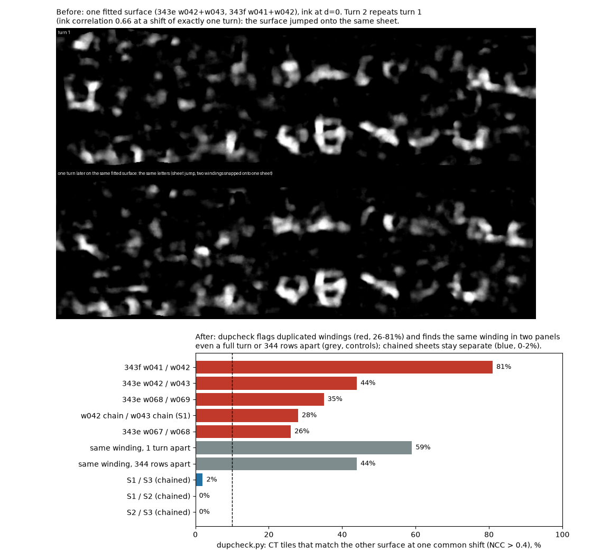
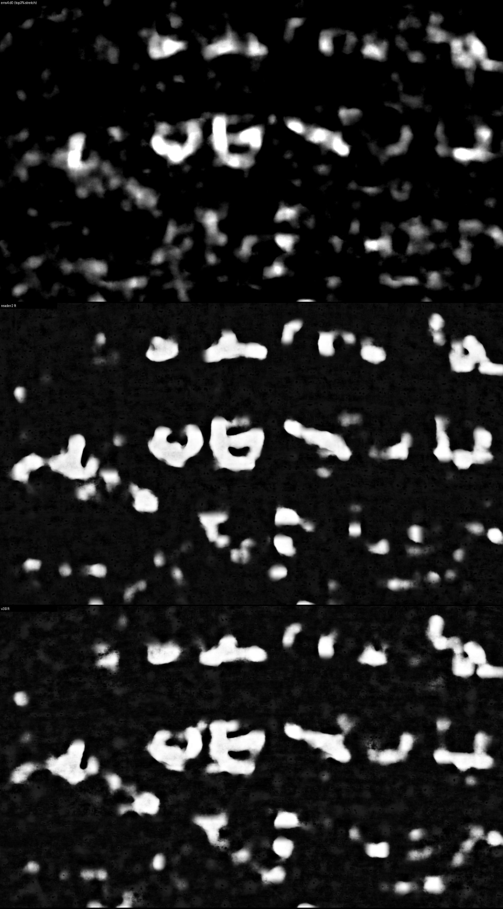

# vesuvius-sheet-chain

Follow one papyrus sheet through a stack of spiral-fit bands, and catch the case where two fitted windings have
landed on the same sheet. By Jashanjot Singh Gill ([@Jashann](https://github.com/Jashann)) and Nhat Nam Tran,
October 2026. MIT licence.

## The problem

The villa spiral fitter is run on one z band at a time (about 1000 slices). Two things then go wrong:

1. **Bands do not line up.** Winding w042 of one band is not w042 of the next. To read a column of text that
   crosses a band boundary you must know which winding continues which, and matching curves at a hard boundary is
   ambiguous (on PHerc. 343 the best and second-best match were 8-15 and 13-20 voxels apart).
2. **The surface jumps across sheets.** After snapping to the sheet prediction, two neighbouring fitted windings can
   end up on the *same* physical sheet. The same letters then appear "on two windings", and anyone counting text or
   building a mesh counts one sheet twice. The fit geometry does not show it: on 343 the raw fits were 6-9 voxels
   apart, so a geometric gap test passes them.

## What is here

| Script | What it does |
|---|---|
| `overlap_chain.py` | Links windings of bands that overlap in z. Compares every pair in the shared slab, keeps a link only when it is the best match both ways and clearly better than the runner-up. Writes sheets as chains of (band, winding). |
| `merge_grids.py` | Joins the windings of one chain into one surface on a common unwrapped-angle axis, with per-band z windows, and blends the seams. |
| `dupcheck.py` | Are two rendered surfaces the same sheet? Tile-wise cross-correlation of the CT texture (fibres and cracks never repeat on separate sheets), at every offset, so a repeat one full turn away or at another z is caught. |
| `bestdepth.py` | Per-patch best depth for ink maps rendered at several depths, so slow surface misfit does not blur letters. |
| `to_tifxyz.py` | Writes a merged sheet (or any fitted winding) as a tifxyz directory that VC3D and villa open. |
| `selftrain.py` | Fine-tunes a public ink model on pseudo-labels from a multi-model ensemble on some sheets, then predicts others (hold one sheet out to check it). Needs villa. |

Inputs are the fitter's band grids: an `.npz` per band whose keys are winding names (`w042`) and whose values are
`(3, rows, cols)` arrays of x, y, z in scan voxels (cells <= 0 are invalid), plus the band umbilicus JSON
(`control_points` with x, y, z).

## Walkthrough

```bash
pip install -r requirements.txt

# 1. Fit bands that overlap by about 500 slices (e.g. z 11300-12300, 11800-12800, 12300-13300, ...).
# 2. Link windings across the overlaps inside one x/y sector; prints links per band pair and writes the chains.
python sheetchain/overlap_chain.py chains.json 3770,5700,2900,4020 e:grids_e.npz ef:grids_ef.npz f:grids_f.npz

# 3. Join one chain into one surface; each band contributes only its own z window.
python sheetchain/merge_grids.py sheets.npz S1 11300 13600 umb.json \
    grids_e.npz:11300:12050 w042 grids_ef.npz:12050:12550 w042 grids_f.npz:12550:13600 w041

# 4. Open it in VC3D, or render it with any renderer that reads tifxyz.
python sheetchain/to_tifxyz.py sheets.npz S1 meshes/

# 5. After rendering (CT at d=0 in ct/d+00.jpg per item): are two surfaces the same sheet?
python sheetchain/dupcheck.py renders/S1 renders/S2

# 6. Optional: self-train an ink model on two sheets, predict all three (S1 never seen in training).
#    renders/<item>/sv.npy is the surface volume (layers, rows, cols), uint8, layer L//2 on the surface and
#    + = away from the umbilicus; renders/<item>/maps/<model>_rev_dXX.png are the untuned ink maps per depth.
KOINE=villa/ink-detection VESUVIUS_SRC=villa/vesuvius/src MODEL=reader2 TRAIN=S2,S3 ITEMS=S1,S2,S3 \
    python sheetchain/selftrain.py renders tuned
```

## Results on PHerc. 343 (scan 20250521140437, 8.64 um, 116 keV)

- Overlap chaining, five bands z 11300-14300: 30-51 windings linked per band pair in the text sector, best match
  about 3 voxels, runner-up 6-17 voxels (hard-boundary matching: best 8-15, runner-up 13-20). It reproduces the
  link we had made by eye for the sheet carrying the clearest letters.
- Duplicate check: chained sheets give 0-2% matching tiles, duplicated windings 26-81% (343f w041/w042 81%,
  343e w042/w043 44%, 343e w067-w069 26-35%, the w042 and w043 chains 28%). As controls, the same winding rendered
  in two different panels is found even a full turn (59%) or 344 rows (44%) away. We count each duplicated group
  once.
- Sheets followed this way show letter rows on three distinct sheets beyond the First Letters mesh (z ~11750 to
  ~13730), two lines per sheet, line spacing 3.5-4.3 mm, in three independently trained ink models.



- Self-training (`selftrain.py`, 2500 steps, labels = top 3% of the 4-model d=0 ensemble of S2 and S3): on S1, which
  was never in training, the tuned reader2 and our v3B model show the same letters as the ensemble with far less
  background and cleaner shapes, and agree with each other. On two chained sheets without text (c5, c7) the tuned
  models give scattered spots but no letter rows, so the tuning does not turn noise into lines.



**Weights:** the self-trained reader-v2 for PHerc. 343 (`reader2_selftrained_343.pt`, 138 MB, sha256 `72f029e320a4c54b614d97de11757d1f3f325101d35800b045335027f8cdb406`) is
attached to the [v0.1 release](https://github.com/Jashann/vesuvius-sheet-chain/releases/tag/v0.1). It is a fine-tune of
[reader-v2](https://huggingface.co/domenicor046/reader-v2) by Domenico Russo (MIT), trained on S2 and S3 only. Use it with
`MODEL=reader2 INIT=reader2_selftrained_343.pt STEPS=0 python sheetchain/selftrain.py renders out` (predict only).

## Related work

- [spiralfiteval](https://github.com/jo-tud/spiralfiteval) (Johannes Pfeffer) scores spiral fits and has a geometric
  duplicate-winding check (fitted surfaces closer than about 2 voxels). `dupcheck.py` covers the case after snapping,
  where fits stay 6-9 voxels apart yet sit on the same sheet, using the CT texture of the rendered surfaces.

## Limits

- Chains are identities of *fits*, not proof of physical sheets: where fitted windings sit 6-9 voxels apart, a chain
  can still contain a slip. Use `dupcheck.py` on the rendered surfaces to decide.
- `overlap_chain.py` works inside one x/y sector at a time; the thresholds (10 voxels, ratio 0.6) were set on 343.
- `dupcheck.py` needs the two renders at the same scale and orientation; it searches in place and around the three
  best global offsets, so a weak or partial overlap can still be missed. About 1-2 minutes per pair on a laptop.
- `selftrain.py` sharpens what the ensemble already shows; it cannot find ink the ensemble misses, and its labels
  inherit the ensemble's mistakes. Always check on a held-out sheet and on a sheet without text.
